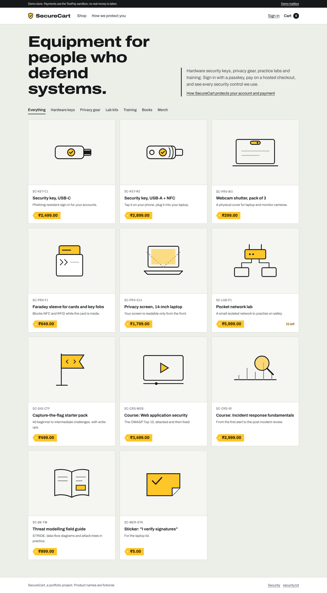
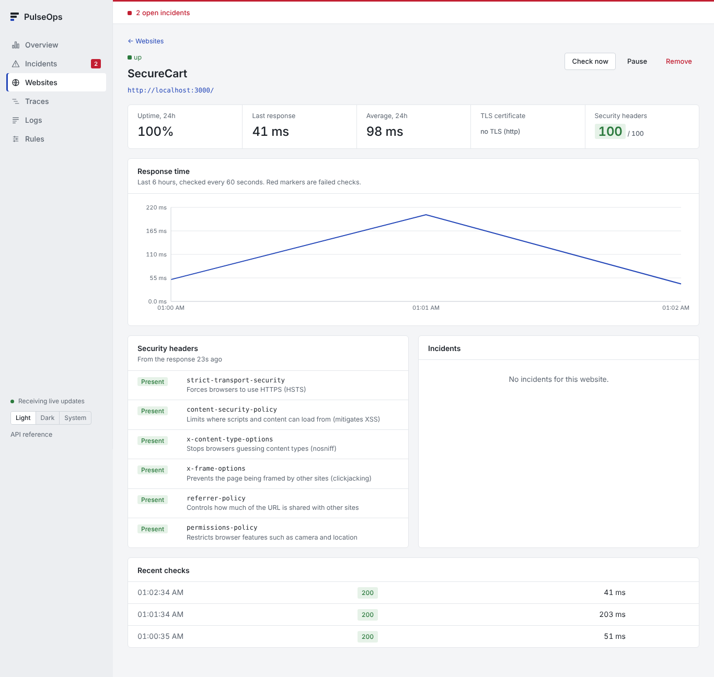
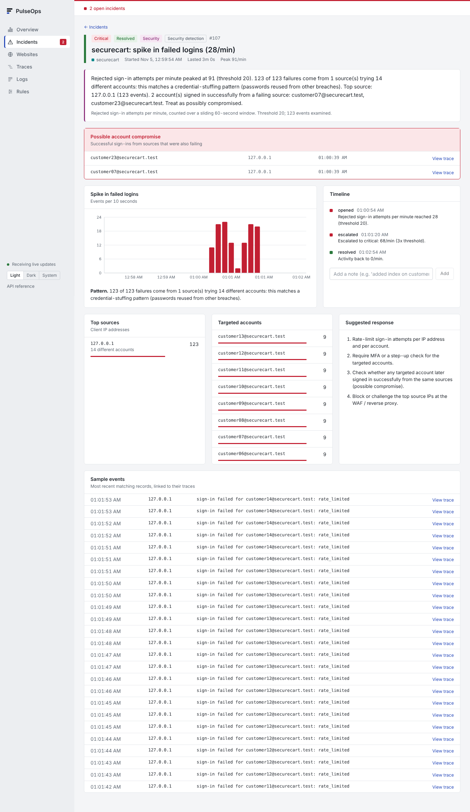
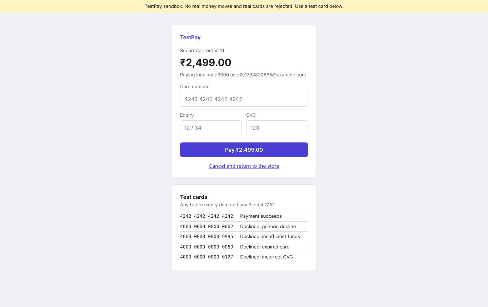
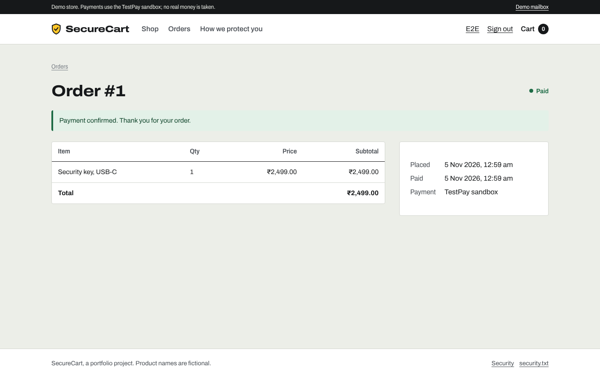
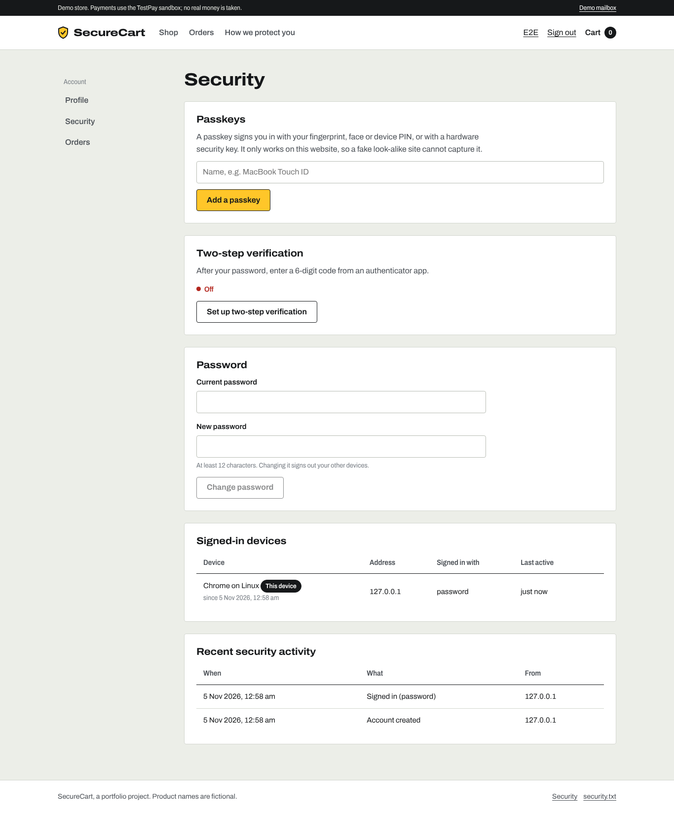
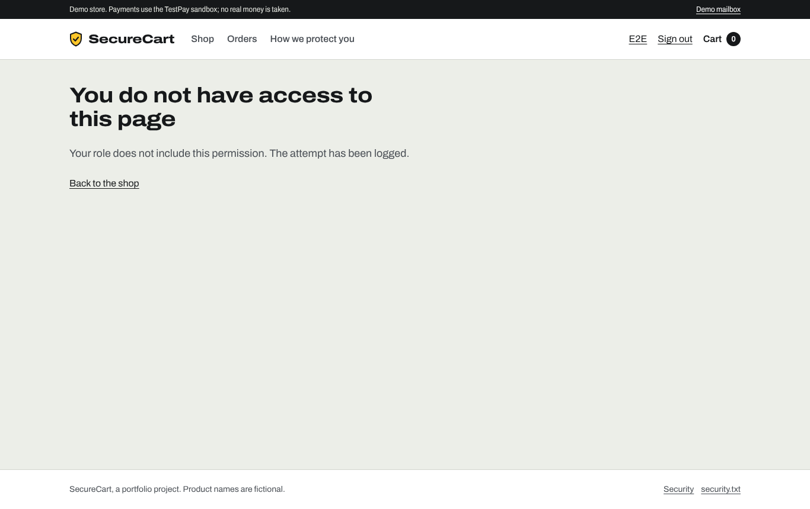
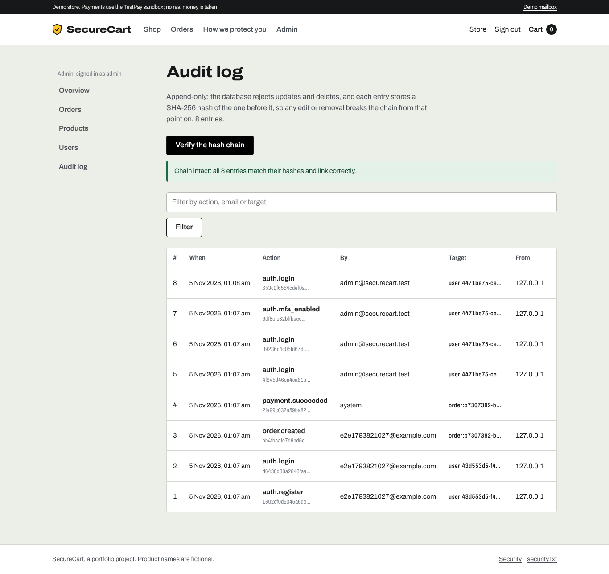

# SecureCart

**A security-hardened online store for cybersecurity gear, built to show secure web development end to end: phishing-resistant sign-in, least-privilege access control, tamper-proof payments and a tamper-evident audit log. It is monitored by [PulseOps](https://github.com/aryachauragade02/pulseops), which detects attacks against it.**



The products are fictional and payments run in a sandbox, so no real money moves. The security controls are real: every one listed below is implemented in this code and covered by tests or the end-to-end checks described at the end.

---

## Quick start

Requires Docker.

```bash
docker compose up -d --build
```

| What | Where |
|---|---|
| Store | http://localhost:3000 |
| TestPay sandbox (fake hosted checkout) | http://localhost:4000 |
| Demo mailbox (password-reset emails) | http://localhost:3000/dev/mailbox |

**Demo accounts** (created on first start):

| Account | Password | Notes |
|---|---|---|
| `shopper@securecart.test` | `correct-horse-battery` | A normal customer |
| `admin@securecart.test` | `Admin-Demo-Pass-2026` | Staff pages need two-step verification first (see below) |
| `support@securecart.test` | `Admin-Demo-Pass-2026` | Can view orders, cannot change prices or roles |

You can also register a new account. **Test card:** `4242 4242 4242 4242`, any future expiry, any CVC. Other test cards on the payment page are always declined.

**Admin access:** sign in as admin, go to **Account → Security**, set up two-step verification with an authenticator app (Google Authenticator, Microsoft Authenticator, 1Password), sign out, and sign in again with the code. Staff pages are only available with a second factor or a passkey.

To stop: `docker compose down` (add `-v` to delete the database).

---

## Features

**Store:** catalogue with categories, product pages, cart, hosted checkout, order history, order status that updates when payment is confirmed.

**Accounts:** registration, sign-in, password reset by email link, passkeys, two-step verification with recovery codes, a list of signed-in devices with remote sign-out, password change.

**Staff panel:** overview, orders (mark shipped, cancel), products (price and stock), users (roles, disable, unlock), audit log with integrity check.

---

## Security controls

### Authentication
| Control | How |
|---|---|
| Passkeys (WebAuthn / FIDO2) | Sign in with Touch ID, Windows Hello or a hardware key. A passkey only works on this site, so it cannot be phished. |
| Two-step verification (TOTP) | Codes from an authenticator app, with 10 single-use recovery codes. Secrets are encrypted at rest with AES-256-GCM; each 30-second code works only once. |
| Password storage | Argon2id with OWASP's recommended parameters. At least 12 characters; common passwords and ones containing the email are rejected. |
| Brute-force protection | 30 sign-in attempts per IP per 10 minutes (sliding window), and an account locks for 15 minutes after 10 wrong passwords. |
| Sessions | Random tokens in `HttpOnly`, `SameSite=Lax` cookies (`Secure` and `__Host-` prefix over HTTPS). Only a SHA-256 of each token is stored. A new session ID on every sign-in. Customer sessions expire after 24 h idle, staff after 30 minutes, all after 7 days. |
| Password reset | Single-use, 30-minute links; only the token's hash is stored; the response is the same whether or not the email exists (no account enumeration). |

### Authorization
| Control | How |
|---|---|
| Role-based access | `customer`, `support`, `admin`, each with only the permissions it needs. Checked on the server for every request. |
| Step-up for staff | Staff pages need a session signed in with a passkey or two-step verification. |
| Object ownership | A customer can only open their own orders. Someone else's order returns 404, so its existence is not revealed (IDOR protection). |
| Denials are recorded | Every refused request is logged as a security event (`authz.denied`), which is what lets PulseOps spot privilege probing. |

### Payments
| Control | How |
|---|---|
| Hosted checkout | Card details are entered on the payment provider's page and never reach this server. |
| Server-side pricing | The amount is calculated from database prices at checkout. Price fields sent by the browser are ignored. |
| Signed webhooks | Payment confirmations are verified with HMAC-SHA256, compared in constant time, and rejected if older than 5 minutes (replay protection). |
| Idempotency | Each provider event is stored by its ID, so a repeated delivery cannot mark an order paid twice. |
| Card-testing defence | An order is cancelled after 3 declined payments; checkout is refused after 5 declines per account or 8 per IP address in 30 minutes. |
| Razorpay test mode | Set `PAYMENT_PROVIDER=razorpay` and your test keys to use Razorpay Checkout instead of the sandbox. |

### Web application (OWASP Top 10)
| Risk | Defence |
|---|---|
| Injection | All database queries are parameterized; all input is validated with Zod schemas (types, lengths, ranges). |
| Cross-site scripting | React escapes output; a Content-Security-Policy with a fresh nonce per response blocks injected scripts. |
| Cross-site request forgery | `SameSite` cookies, plus the server rejects state-changing API requests whose `Origin` or `Sec-Fetch-Site` shows another site. |
| Clickjacking | `frame-ancestors 'none'` and `X-Frame-Options: DENY`. |
| Security headers | HSTS, CSP, `X-Content-Type-Options`, `X-Frame-Options`, `Referrer-Policy`, `Permissions-Policy`: PulseOps scores the store **100/100**. |
| Spoofed client IPs | A client-supplied `X-Forwarded-For` is ignored unless a trusted proxy is configured, so rate limits cannot be dodged. |
| Open redirects | Post-login redirects only accept same-site paths. |
| Vulnerability disclosure | `/.well-known/security.txt` (RFC 9116) and a public `/security` page. |

### Forensics: tamper-evident audit log
Sign-ins, two-step changes, passkey changes, password changes, role changes, price and stock edits, order shipping and cancellation, payments, and payments that need a refund are written to an append-only audit log. Each entry stores the SHA-256 hash of the previous entry, like a small blockchain, and database triggers reject any `UPDATE`, `DELETE` or `TRUNCATE`. **Verify the hash chain** in the admin panel recomputes every hash and reports the first broken entry if anything was altered.

---

## Monitoring with PulseOps

SecureCart sends traces and logs to PulseOps over OpenTelemetry. Security-relevant actions are logged as structured events (`auth.login_failed`, `auth.login_succeeded`, `payment.declined`, `authz.denied` and others) without passwords, tokens or card data.

1. Start PulseOps (`docker compose up -d` in the PulseOps folder; dashboard on http://localhost:8000).
2. Start SecureCart. Its telemetry goes to PulseOps automatically.
3. In PulseOps, open **Websites** and add `http://host.docker.internal:3000/` to monitor the store's uptime, response time and security headers.



### Attack demo

```bash
docker compose --profile attack run --rm attack-simulator
```

This replays three common attacks against **your own local store only**. The script refuses any target that isn't localhost or a Docker-internal name, uses only the seeded demo accounts and the sandbox's test cards, and stops by itself after about four minutes.

| Attack | What the store does | What PulseOps shows |
|---|---|---|
| **Credential stuffing:** passwords from a fictional "leaked list" tried across 40 accounts | Rate limiting blocked 98 of 125 attempts in our run; two accounts with reused passwords were still taken over | "Spike in failed logins", classified as a credential-stuffing pattern, naming the 2 accounts that signed in from the attacking source as possibly compromised |
| **Card testing:** small purchases with declined test cards | Orders cancelled after 3 declines, then checkout refused: 47 attempts blocked | "Burst of declined payments" |
| **Privilege probing:** a customer calling admin-only APIs | All 93 requests denied with 403 | "Spike in forbidden requests" |



The takeaway for the demo: the rate limiter slowed the attack, but two customers who reused a breached password were still compromised. Detection is what tells you which accounts to lock and reset, and passkeys or two-step verification are what stop it outright.

---

## Screenshots

| Hosted checkout (sandbox) | Paid order |
|---|---|
|  |  |
| **Account security** | **Customer opening the admin panel** |
|  |  |
| **Audit log with hash-chain check** | |
|  | |

---

## Architecture

```
Browser ──► SecureCart (Next.js + custom Node server) ──► PostgreSQL
               │   │                                      (users, sessions, orders,
               │   └── OpenTelemetry traces + security      rate limits, audit log)
               │       events ──────────────────────────► PulseOps
               ▼
        TestPay sandbox  ── signed webhook ──► /api/webhooks/testpay
        (or Razorpay test mode)
```

| Part | Technology |
|---|---|
| Web app and API | Next.js 16 (App Router), React 19, TypeScript |
| Database | PostgreSQL 16 with SQL migrations |
| Validation | Zod |
| Passwords | Argon2id (`@node-rs/argon2`) |
| Passkeys | SimpleWebAuthn |
| Two-step verification | `otpauth` (RFC 6238 TOTP), AES-256-GCM for secrets at rest |
| Payments | TestPay sandbox (included) or Razorpay test mode |
| Telemetry | OpenTelemetry SDK, OTLP to PulseOps |
| Tests | Vitest |
| Running | Docker Compose |

```
securecart/
├── docker-compose.yml
├── .env.example                 # override demo secrets here (copy to .env)
├── app/
│   ├── server.mjs               # records the real client IP before Next.js handles a request
│   ├── migrations/001_init.sql  # schema, incl. append-only audit log triggers
│   ├── scripts/                 # migrate, seed, simulate-attacks
│   ├── src/proxy.ts             # CSP nonce, CSRF origin check
│   ├── src/lib/                 # auth, sessions, passkeys, TOTP, RBAC, rate limits, audit, payments
│   ├── src/app/                 # pages and API routes
│   └── tests/security.test.ts   # 25 security unit tests
└── testpay/server.mjs           # the sandbox payment provider
```

---

## Running without Docker (development)

Requires Node.js 22 and PostgreSQL 16.

```bash
createuser securecart -P            # password: securecart
createdb securecart -O securecart

cd testpay && node server.mjs &     # set the TESTPAY_* variables from docker-compose.yml first
cd app && npm install
export DATA_ENCRYPTION_KEY=$(openssl rand -base64 32) DEMO_MODE=true SEED_DEMO_USERS=true SEED_ADMIN_PASSWORD=Admin-Demo-Pass-2026
npm run migrate && npm run seed
npm run dev                         # http://localhost:3000
npm test                            # security unit tests
```

---

## What was verified

- **25 unit tests** (`npm test`): password policy, webhook signatures and the replay window, audit-chain tamper detection, TOTP and code reuse, encryption at rest, client-IP handling, safe redirects, role permissions, money arithmetic, rate-limit maths and constant-time comparison.
- **End-to-end in a real browser:** register, add to cart, pay on the hosted page, order marked paid by the signed webhook; customer refused from admin pages; admin sets up two-step verification, signs in with a code, uses every staff page, and the audit chain verifies as intact.
- **Manual attack checks:** another customer's order returns 404; a cross-site POST returns 403; a forged webhook signature is rejected; a price sent by the browser is ignored; quantities above 10 are rejected.
- **Attack simulation with PulseOps:** all three attacks raised the expected security incidents.

## Limitations

- Demo secrets are in `docker-compose.yml` so it runs with one command. Set real values in `.env` before deploying anywhere.
- Served over plain HTTP locally; use HTTPS in any real deployment, which turns on `Secure` cookies and `upgrade-insecure-requests` automatically.
- Emails are written to a demo mailbox table instead of being sent.
- This is a portfolio project, not a certified payment system.
